<div align="center">


# Pennywise

**A personal finance dashboard that turns accounts, budgets and goals into answers.**
Where the money went, what renews next, and whether you are on track.


[Features](#features) · [Design](#design) · [Screenshots](#screenshots) · [Tech stack](#tech-stack) · [Getting started](#getting-started)

</div>

<picture>
  <source media="(prefers-color-scheme: dark)" srcset="readme/hero-dark.png">
  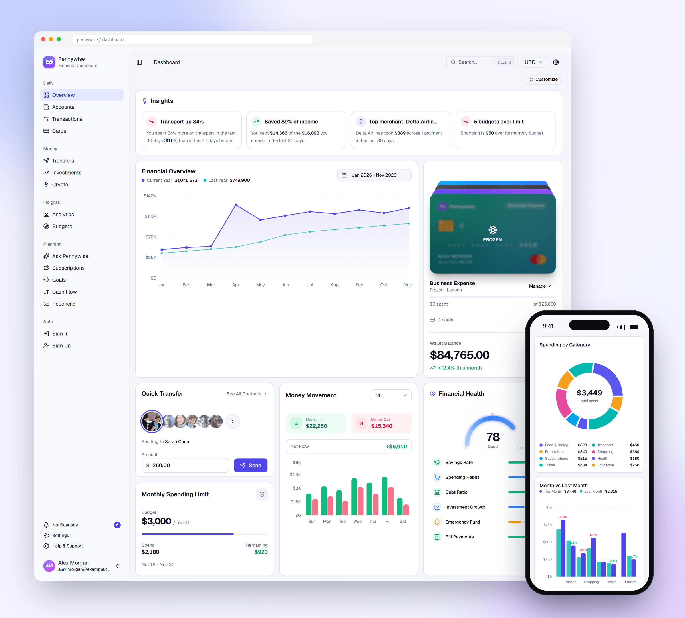
</picture>

## Overview

Pennywise is a single-user finance workspace. It covers the day-to-day (accounts, transactions, cards, transfers), the long view (analytics, investments, crypto) and a **Planning** section for subscriptions, savings goals, cash flow, statement reconciliation and an AI assistant that answers questions about your own numbers.

It is built for people who want answers rather than raw tables, and it is designed as a portfolio-grade reference for a data-dense Next.js dashboard. It runs on a realistic seeded data set, so it works with zero setup: no database, no auth provider and no API keys.

## Quick start

```bash
pnpm install && pnpm dev   # then open http://localhost:3000
```

The root route opens the dashboard. Sign-in and sign-up are UI only until the auth and persistence layer on the roadmap lands.

- Add, edit or delete transactions, budgets and goals. Changes persist in `localStorage`.
- **Ask Pennywise** works offline out of the box. Add an `ANTHROPIC_API_KEY` to get streamed answers from Claude instead.

## Features

### Ask Pennywise, an assistant grounded in your own data

Ask "Where did my money go this month?" and get an answer built from your actual transactions, budgets and goals. With a key, a route handler streams Claude's reply. Without one, an offline responder computes the same answers locally, so the feature always works.

<picture>
  <source media="(prefers-color-scheme: dark)" srcset="readme/assistant-dark.png">
  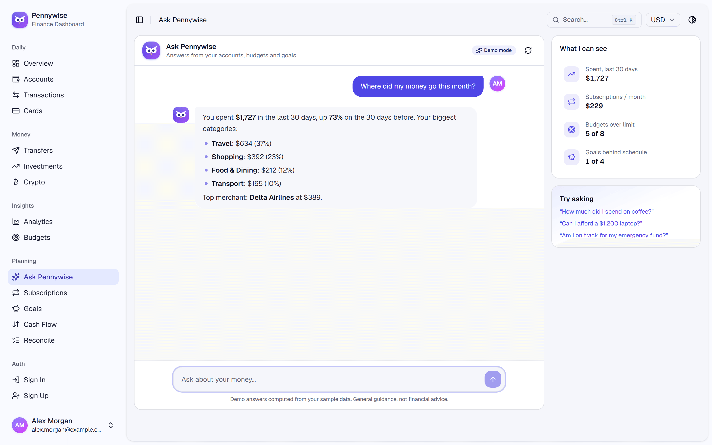
</picture>

### Subscriptions that pay for themselves

Every recurring charge is detected from transactions. The page shows monthly and yearly cost, the next 30 days of renewals, price increases, and services unused for 30+ days with what cancelling them would save.

<picture>
  <source media="(prefers-color-scheme: dark)" srcset="readme/subscriptions-dark.png">
  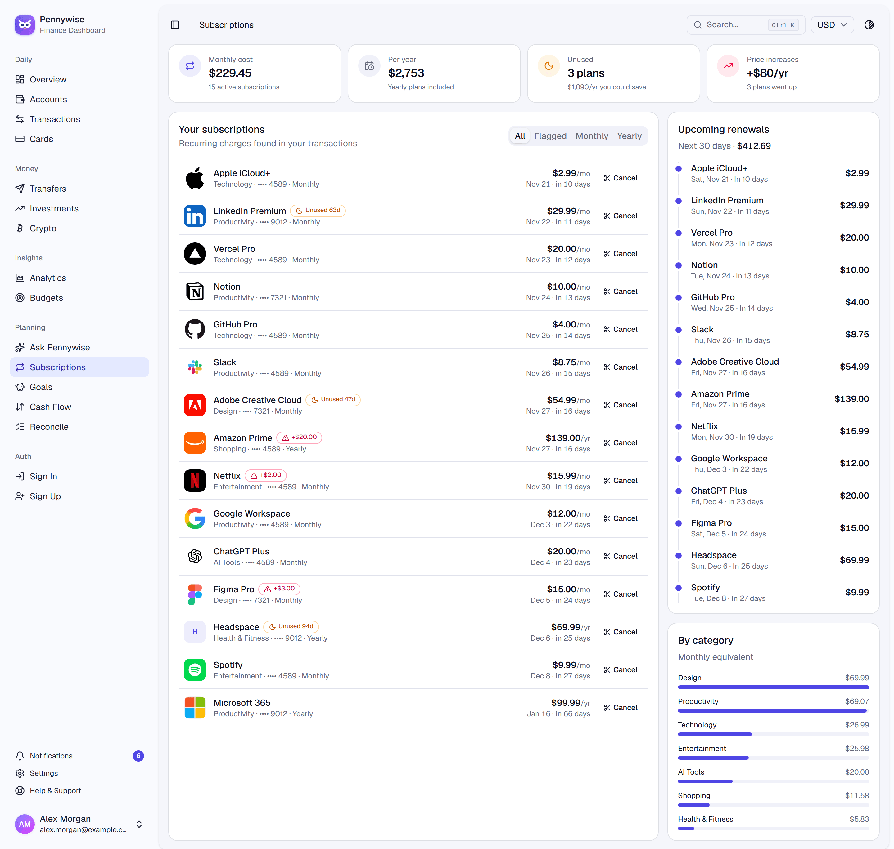
</picture>

### Cash flow, month by month

Income against expenses for 6 or 12 months, with a savings-rate line, income sources, and spending grouped by category, so trends stand out at a glance.

<picture>
  <source media="(prefers-color-scheme: dark)" srcset="readme/cash-flow-dark.png">
  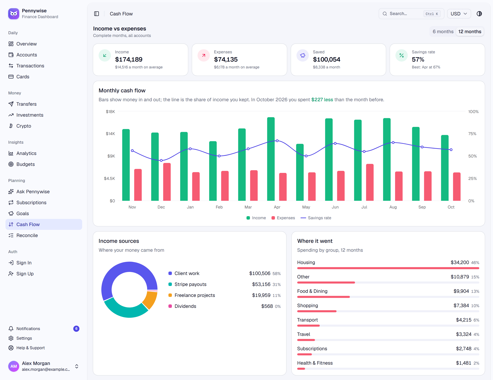
</picture>

### Analytics and insights

A 365-day spending heatmap, a category donut, month-over-month comparison, a recurring-charge detector and plain-language insights such as "Transport costs dropped 13%".

<picture>
  <source media="(prefers-color-scheme: dark)" srcset="readme/analytics-dark.png">
  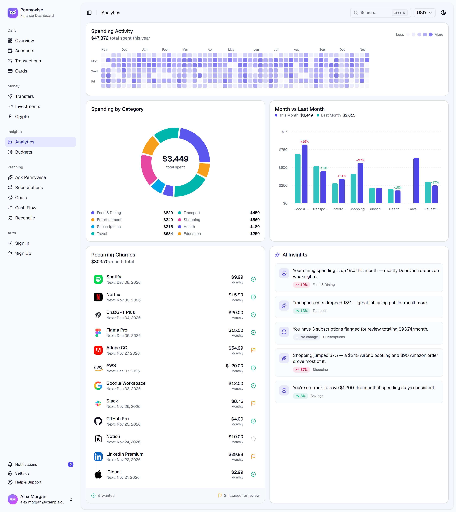
</picture>

### Everything else

| Area | What you get |
|---|---|
| **Dashboard** | Drag-and-drop widgets (dnd-kit) with a Customize mode and saved order; insight cards for spending spikes, savings rate, top merchant and budgets over limit |
| **Transactions** | Search, filters, expandable rows, CSV export of filtered or selected rows (escaped against spreadsheet formula injection) |
| **Cards & transfers** | 3D card flip, freeze toggle, spending limits, a virtual card generator, quick transfers to saved contacts |
| **Goals** | Progress rings, required monthly contribution, projected finish date and an "on track / behind" timeline |
| **Reconcile** | A card statement matched line by line against transactions: exact, suggested (merchant + date gap) or unmatched |
| **Markets** | Investments with allocation, sparklines and a simulated live ticker; crypto with candlesticks and a trade form |
| **Power tools** | Command palette, USD/EUR/GBP switcher, light/dark/system themes |

## Design

Pennywise uses one design system end to end: shadcn/ui primitives on Base UI, themed with OKLCH tokens in `globals.css`. The brand is an indigo-violet primary (`oklch(0.51 0.23 277)`) on near-white surfaces, typeset in Geist and Geist Mono, with a single `--radius` (0.625 rem) that every corner derives from.

- **Light and dark, equally polished.** Every token has a dark counterpart (deep indigo surfaces instead of pure black). Charts use the same chart tokens, so both themes stay on brand.
- **Responsive by layout, not by hiding.** The sidebar collapses to a sheet, grids reflow to one column, and tables become stacked cards down to 375 px.
- **Motion with restraint.** Count-up numbers, chart draw-ins and the chat's streaming dots all respect `prefers-reduced-motion` (`useReducedMotion` from Motion).
- **Accessible controls.** Icon buttons carry `aria-label`s, row actions appear on keyboard focus and on touch screens (`pointer-coarse`), not only on hover.
- **Honest states.** Skeleton loaders, empty states with a next action, and a toast for every write.

<p align="center">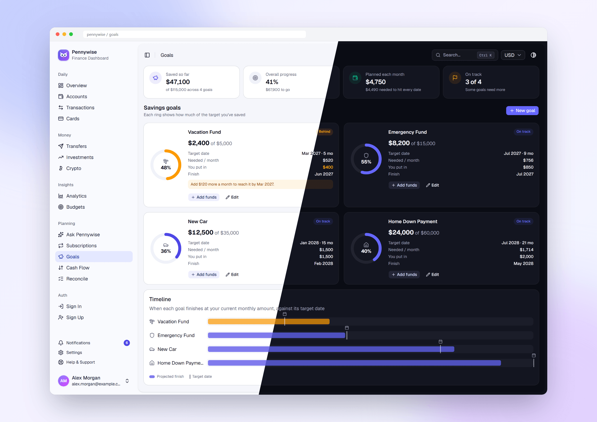</p>

<picture>
  <source media="(prefers-color-scheme: dark)" srcset="readme/mobile-dark.png">
  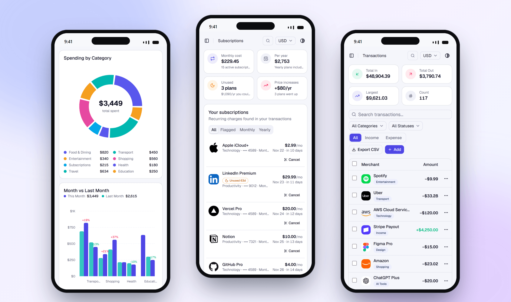
</picture>

## Screenshots

<table>
  <tr>
    <td width="50%">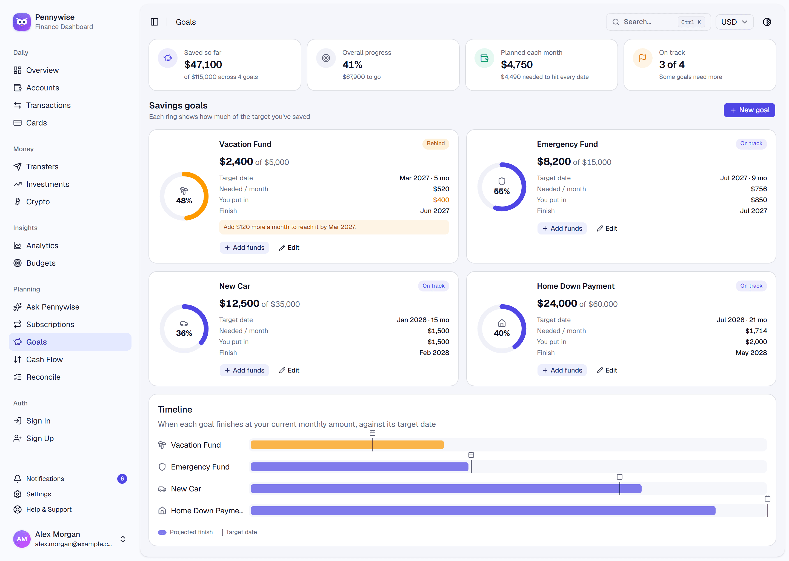<br><sub><b>Goals</b>: rings, monthly target and a finish-date timeline</sub></td>
    <td width="50%">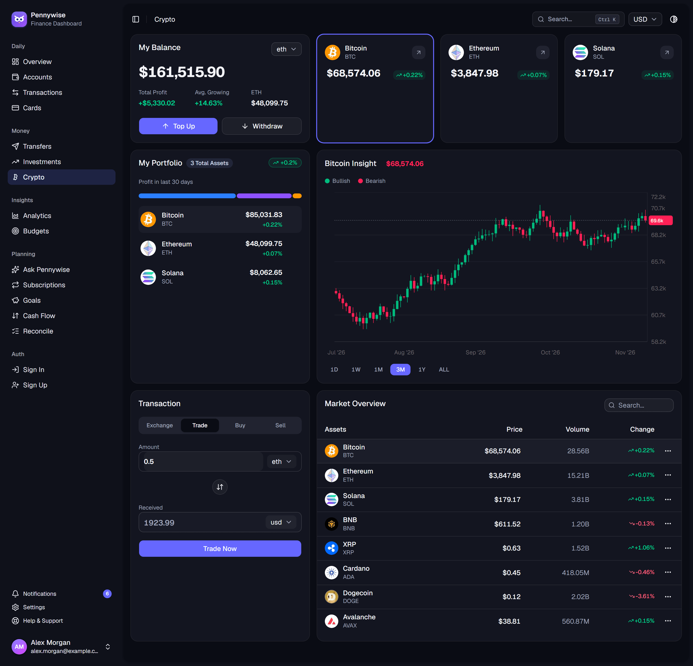<br><sub><b>Crypto</b> (dark): candlesticks, portfolio and market overview</sub></td>
  </tr>
  <tr>
    <td width="50%">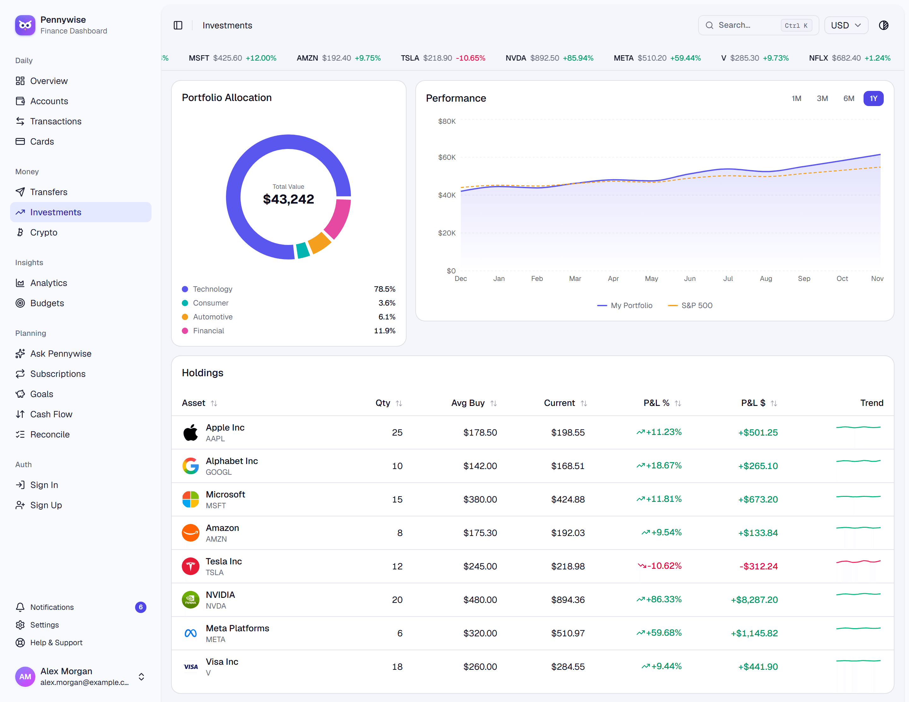<br><sub><b>Investments</b>: allocation, performance vs S&amp;P 500, holdings</sub></td>
    <td width="50%">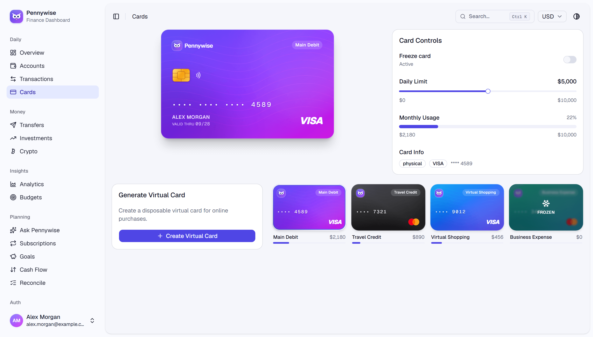<br><sub><b>Cards</b>: controls, limits and a virtual card generator</sub></td>
  </tr>
  <tr>
    <td width="50%">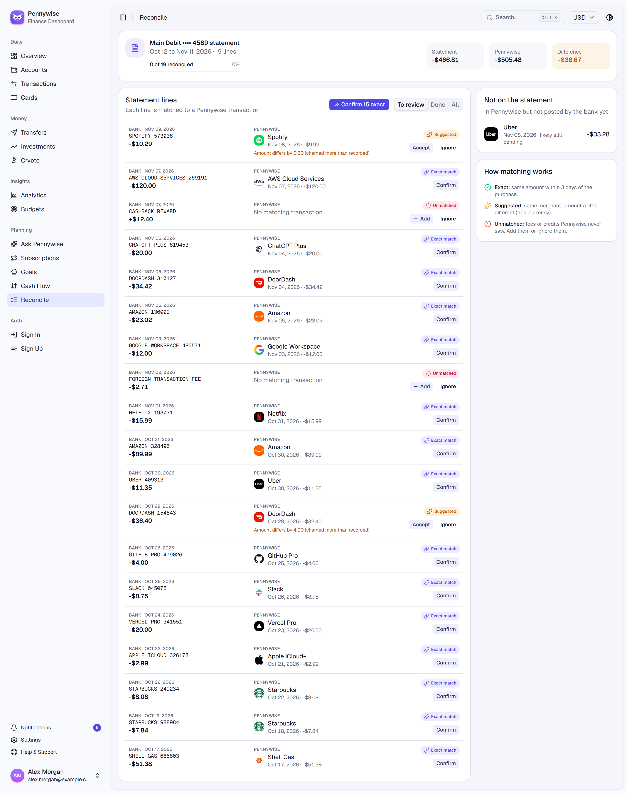<br><sub><b>Reconcile</b>: statement lines matched to transactions</sub></td>
    <td width="50%">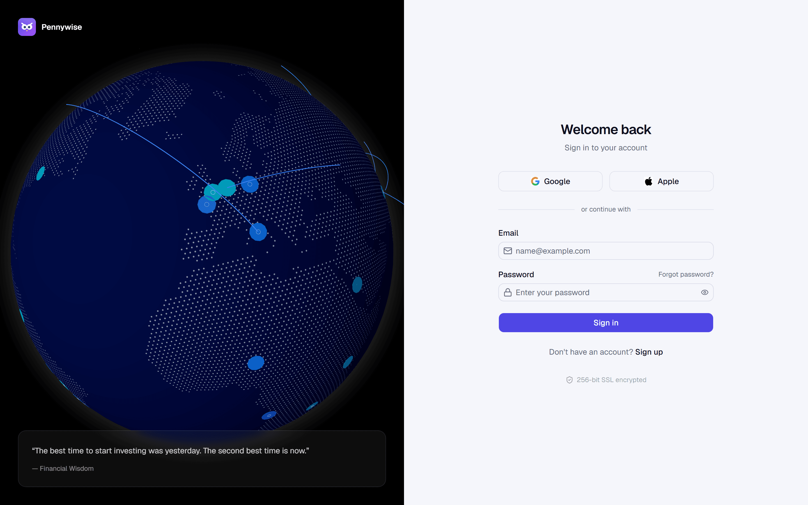<br><sub><b>Sign in</b> with the interactive 3D globe</sub></td>
  </tr>
</table>

## Tech stack

| Layer | Technology | Why |
|---|---|---|
| Framework | Next.js 16.2 (App Router, Turbopack) | File-based routing with route groups, one server route for the AI |
| UI runtime | React 19.2, TypeScript 5 (strict) | `useSyncExternalStore` for the finance store, strict types everywhere |
| Components | shadcn/ui on Base UI 1.4, lucide-react, cmdk | Owned, accessible primitives; the command palette |
| Styling | Tailwind CSS 4, tw-animate-css, next-themes | OKLCH design tokens and class-based theming |
| Charts | Recharts 3.8 | Composable charts that read the same tokens |
| Motion | Motion 12 | Count-ups and draw-ins with reduced-motion support |
| Drag and drop | @dnd-kit/core 6, @dnd-kit/sortable 10 | Keyboard-accessible widget reordering |
| 3D | three 0.183, three-globe, @react-three/fiber | The sign-in globe |
| AI (optional) | @anthropic-ai/sdk, `claude-sonnet-5-5` | Streamed, data-grounded answers |
| Dates | date-fns 4, react-day-picker 9 | Relative mock dates and pickers |

## Architecture

All pages are client-rendered React on top of one seeded data module. A small store layers the user's edits over the seed, and pure functions derive everything else. The only server code is the optional assistant route.

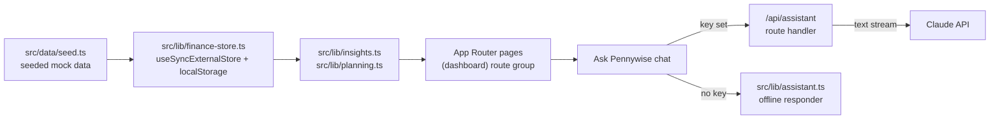

Key decisions and trade-offs:

- **Deterministic mock data.** The seed uses a seeded PRNG, so server and client render identical numbers and there are no hydration mismatches. Dates are authored relative to "today" and shifted at runtime, so the data never looks stale.
- **A store instead of a backend.** Edits live in `localStorage` under a versioned key. The trade-off is single-device data, in exchange for zero setup. The store has the same shape a real API would, so it can be swapped later.
- **AI without lock-in.** `GET /api/assistant` tells the page whether a key is configured. The key never reaches the browser, and without it the same questions are answered by deterministic code.
- **One currency internally.** Amounts stay in USD and are converted only at display time by `<Money>`, which keeps totals and exports consistent.

## Engineering highlights

- **Type safety.** TypeScript strict mode; domain types (`FullTransaction`, `BudgetCategory`, `SavingsGoal`) flow from the seed through the store to every component.
- **Hydration-safe client state.** The server and the first client render always use the seed. The saved copy swaps in after hydration through `useSyncExternalStore`.
- **Defensive I/O.** Every storage read and write is wrapped in `try/catch` with validation of the saved shape, so private windows, full storage and corrupt JSON all degrade to the seed.
- **Input hardening on the AI route.** Only `user`/`assistant` turns pass, history is capped at 20 turns and 4,000 characters each, the data snapshot at 40 KB, and API errors map to friendly messages without leaking details.
- **Security.** CSV export neutralises formula injection (`=`, `+`, `-`, `@` prefixes). No trackers, no `eval`, no secrets in the client.
- **Quality gates.** `tsc --noEmit` and ESLint pass with zero warnings, and CI runs type check, lint and build on every push and pull request.

The finance store reads saved data defensively and never trusts its shape:

```ts
// src/lib/finance-store.ts
function load() {
  if (loaded || typeof window === "undefined") return
  loaded = true
  try {
    const raw = window.localStorage.getItem(STORAGE_KEY)
    if (!raw) return
    const saved = JSON.parse(raw) as Partial<FinanceState>
    state = {
      transactions: Array.isArray(saved.transactions) ? saved.transactions : defaultState.transactions,
      budgets: Array.isArray(saved.budgets) ? saved.budgets : defaultState.budgets,
      goals: Array.isArray(saved.goals) ? saved.goals : defaultState.goals,
      currency: isCurrency(saved.currency) ? saved.currency : "USD",
    }
  } catch {
    // Corrupt or blocked storage: fall back to the seed data
  }
}
```

A seeded PRNG keeps server and client output identical:

```ts
// src/lib/mock.ts
// Seeded PRNG (mulberry32) so mock data is identical on the server and the
// client — Math.random() at render time causes hydration mismatches.
export function seededRandom(seed: number) {
  let a = seed >>> 0
  return () => {
    a = (a + 0x6d2b79f5) >>> 0
    let t = a
    t = Math.imul(t ^ (t >>> 15), t | 1)
    t ^= t + Math.imul(t ^ (t >>> 7), t | 61)
    return ((t ^ (t >>> 14)) >>> 0) / 4294967296
  }
}
```

## Getting started

### Prerequisites

- Node.js 20 or newer
- pnpm 10 (the version CI uses). With pnpm 11, run `pnpm approve-builds` once after installing, because pnpm 11 refuses to run scripts while the `sharp` and `unrs-resolver` build steps are unapproved.

### Install and run

```bash
git clone <your-fork-url> pennywise
cd pennywise
pnpm install
pnpm dev
```

Open `http://localhost:3000`. You should land on the dashboard with insights, a financial overview chart and a stack of cards.

<details>
<summary><b>Environment variables</b></summary>

None are required. To enable live AI answers:

```bash
cp .env.example .env.local
```

| Variable | Required | Description |
|---|---|---|
| `ANTHROPIC_API_KEY` | No | Enables Claude answers in Ask Pennywise. Without it the assistant answers offline. Server-side only. |

</details>

<details>
<summary><b>Scripts</b></summary>

| Script | What it does |
|---|---|
| `pnpm dev` | Start the dev server on port 3000 |
| `pnpm build` | Production build |
| `pnpm start` | Serve the production build |
| `pnpm lint` | ESLint (Next.js config) |
| `pnpm exec tsc --noEmit` | Type check |

</details>

<details>
<summary><b>Project structure</b></summary>

```
src/
├── app/
│   ├── (auth)/              sign-in / sign-up with the 3D globe
│   ├── (dashboard)/         dashboard, accounts, transactions, cards, transfers,
│   │                        investments, crypto, analytics, budgets, assistant,
│   │                        subscriptions, goals, cash-flow, reconcile, settings
│   ├── api/assistant/       optional Claude streaming route
│   └── layout.tsx           metadata, theme provider, fonts
├── components/
│   ├── dashboard/           widgets and the drag-and-drop customizer
│   ├── planning/            subscriptions, goals, cash flow, reconcile
│   ├── assistant/           chat UI
│   ├── ui/                  shadcn/ui primitives
│   └── command-palette.tsx  Ctrl/⌘ + K
├── data/seed.ts             sample user, accounts, transactions, holdings
└── lib/
    ├── finance-store.ts     persisted user edits
    ├── insights.ts          dashboard insight cards
    ├── planning.ts          subscription, goal and cash-flow maths
    ├── assistant.ts         offline assistant answers
    ├── currency.ts          conversion and formatting
    └── mock.ts              seeded PRNG and relative dates
```

</details>

## Testing and quality

```bash
pnpm exec tsc --noEmit
pnpm lint
```

Both pass with zero errors and zero warnings, and CI (`.github/workflows/ci.yml`) runs type check, lint and build on every push and pull request to `main`. There is no automated test suite yet. The derivation logic in `src/lib/planning.ts` and `src/lib/insights.ts` is pure and is the first candidate for unit tests.

## Deployment

A standard Next.js project: deploy to Vercel or any Node host (`pnpm build && pnpm start`) with no configuration. Set `ANTHROPIC_API_KEY` only if you want live assistant answers; that route is the only part that needs a server runtime.

## Roadmap

- Unit tests for the insight, subscription and goal-projection functions, plus Playwright smoke tests per route.
- A real persistence layer (Postgres + auth) behind the same store interface.
- Bank data import (CSV/OFX first, then an aggregator) feeding Reconcile.
- Live FX rates instead of fixed conversion factors.